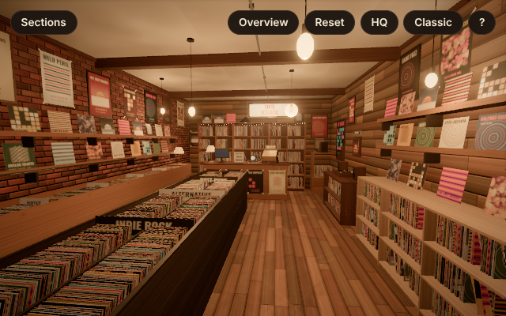

# Vinyl Ecstatic: a walkable 3D portfolio

A first-person, fully 3D independent record store that doubles as a personal portfolio. Visitors walk the aisles, look at records, signs and gadgets, and press **E** (or tap) to open portfolio panels. A conventional HTML portfolio is always one click away and takes over automatically if WebGL is unavailable.



Built with React, TypeScript, Three.js, React Three Fiber, Drei and Vite. Deployed to GitHub Pages by GitHub Actions.

## Quick start

```bash
npm install
npm run dev        # http://localhost:5173
npm run build      # type-check + production build into dist/
npm run preview    # serve dist/ locally
```

Useful URL flags:

| Flag | Effect |
| --- | --- |
| `?classic` | open the plain HTML portfolio |
| `?colliders` | show the collision volumes as wireframes |
| `?debug` | expose `__veTeleport(x, z, yaw, pitch)`, `__veSet(state)` and `__veDebug()` (state, pose, renderer stats) on `window` for QA scripts |
| `?export` | download the generated shop as `vinyl-store.glb` once it has rendered |
| `?nobatch` | skip runtime mesh batching (keeps every object separate, used by the export) |

## Controls

| Desktop | Touch |
| --- | --- |
| Click to capture the mouse, **mouse** to look | **drag** anywhere to look |
| **W A S D** / arrows to walk, **Shift** to run | **left stick** to walk |
| **E** to open what is under the crosshair | **tap** an object, or the **Open** button |
| **Esc** releases the mouse / closes a panel | ✕ closes a panel |

The top bar has a keyboard-accessible **Sections** menu, an **Overview** (orbit) view, **Reset** to the entrance, a quality toggle and **Classic** view. If pointer lock is unavailable (for example inside an iframe), the desktop falls back to drag-to-look plus the on-screen stick.

## Editing the portfolio content

Everything a visitor reads lives in [`src/data/portfolio.ts`](src/data/portfolio.ts): owner details, about, contact, categories, projects and experience. Sample entries are marked **EXAMPLE**; replace them with your own.

- **Add a project:** append to `projects`. It automatically gets a generated album sleeve on the project wall (left wall, eye-level shelf), an interaction id `record:<id>`, a place in its genre bin's list and an entry in the classic layout. Set `featured: true` on one project to put it in the NOW PLAYING frame.
- **Rename the genre bins:** edit `categories`. The `genre` string is printed on the island's divider cards.
- **Change what an object opens:** edit `interactions` at the bottom of the file. Targets can be a section, a project, a category or an external link.

## How the 3D scene is organised

```
src/
  data/portfolio.ts        content + interaction map (no 3D code)
  state/store.ts           tiny shared store (mode, open panel, hovered object, quality)
  scene/
    layout.ts              room dimensions, furniture footprints, coordinate conventions
    Experience.tsx         <Canvas>, renderer settings, post-processing, overview camera
    Store.tsx              assembles the shop: wall decor, interactive objects, lights
    Architecture.tsx       floor, ceiling, walls, entrance, wall culling
    Furniture.tsx          modular bins, island, shelving, counter, cabinets, wall shelves
    assets/primitives.tsx  WoodBox, instanced Sleeves, face-out sleeves, vinyl disc
    assets/fixtures.tsx    lamps, cash register, turntable, posters, signs, speakers
    geometry.ts            world-UV boxes/planes, sleeve and vinyl geometry
    materials.ts           shared PBR materials, instanced sleeve atlas shader
    textures/              procedural wood, brick, plaster, album art, posters, signs
    prepare.ts             generates textures up front with a progress bar
  controls/                first-person controls, input state, collision
  interaction/             Interactive/Occluder wrappers and the raycasting interactor
  ui/                      welcome, HUD, panel, touch controls, classic layout
  tools/exportGlb.ts       GLB export of the generated shop
scripts/
  export-glb.mjs           headless export to blender/vinyl-store.glb
  blender/glb_to_blend.py  builds blender/vinyl-store.blend from the GLB
```

[`docs/SCENE.md`](docs/SCENE.md) documents the coordinate system, dimensions, scene hierarchy and object names, interaction ids and materials.

### Modifying the room

- **Move or resize furniture:** edit its footprint in `FURNITURE` in `layout.ts`. The mesh and its collider both follow.
- **Add furniture:** add a footprint to `FURNITURE` (it becomes a collider automatically), build a component in `Furniture.tsx` from `WoodSpan` panels and `Sleeves` runs (`binRun` for records filed face-forward, `spineRun` for shelved records), then place it in the right wall group in `Store.tsx`.
- **Lights:** pendant positions are in `PENDANTS` in `layout.ts`. The two pendants with `shadowSpot` cast shadows in high quality.

### Adding a new interactive object

1. Add an entry to `interactions` in `src/data/portfolio.ts`, e.g. `'poster:cv': { verb: 'download my CV', target: { kind: 'link', url: '/cv.pdf' } }`.
2. Wrap the object in `<Interactive target="poster:cv">…</Interactive>` inside `InteractiveObjects` in `Store.tsx`.

That's all: the interactor raycasts against everything inside `Interactive` and `Occluder` groups, shows the prompt using `verb`, and opens the target on **E** or tap.

### Blender project and GLB

The repository includes the shop as editable assets:

| File | What it is |
| --- | --- |
| `blender/vinyl-store.glb` | the whole shop exported from the running site: every object separate and named per `docs/SCENE.md`, PBR materials and textures embedded, lights as `KHR_lights_punctual` |
| `blender/vinyl-store.blend` | the same scene as a Blender 5.2 project: one collection per top-level group, textures packed, a `VisitorCamera` at the spawn point, metric units |

Regenerate both after changing the scene:

```bash
npm i -D playwright && npx playwright install chromium   # once
npm run build && npx vite preview --port 4173 &
npm run export:glb                                       # writes blender/vinyl-store.glb
blender --background --python scripts/blender/glb_to_blend.py -- blender/vinyl-store.glb blender/vinyl-store.blend
```

(`pip install bpy` and `python scripts/blender/glb_to_blend.py <in> <out>` works too, without a Blender install.)

Instanced records export via `EXT_mesh_gpu_instancing`. Their per-instance cover selection is a custom shader feature, so outside this site each instanced sleeve shows the whole cover atlas. At runtime the site also merges static meshes into one per material (`StaticBatch`) to cut draw calls; the export uses `?nobatch` so objects stay separate.

### Replacing procedural assets with Blender models

Every asset is generated in code, which keeps the repository small and makes the shop data-driven. To swap one for a hand-made model:

1. Open `blender/vinyl-store.blend` (or import the GLB). Object names match `docs/SCENE.md`, so it's a ready-made reference for position and scale. glTF is Y-up; Blender maps glTF (x, y, z) to (x, −z, y).
2. Model the replacement at the same origin and scale (metres, origin as documented for that component), apply transforms and export as GLB to `public/models/`.
3. Load it in place of the procedural component with Drei's `useGLTF('/models/<name>.glb')`, keeping the same `Interactive` wrapper and footprint.

## Deployment

`.github/workflows/deploy.yml` builds the site and publishes `dist/` to GitHub Pages on every push to `main`. In the repository settings, set **Pages → Source** to **GitHub Actions**.

## Artwork and licensing

All album art, band names, posters and signage are generated procedurally and are fictional. The reference photo only guided layout and atmosphere. No copyrighted artwork is reproduced.
